<a href="https://orcha-official.up.railway.app">افتح العرض المباشر</a> · <a href="https://github.com/RanimAlyaseen/Orcha-App">المصدر</a>

<a href="https://github.com/RanimAlyaseen/casie-event-argument-extraction">المصدر</a>

<a href="https://github.com/RanimAlyaseen/tourism-crm-dbms">المصدر</a>

<table><tr>
<td width="33%"></td>
<td width="33%"></td>
<td width="33%"></td>
</tr></table>

<a href="https://drive.google.com/drive/folders/1t_D6z8vG5mqFVUuV0Yiw7lJgMr2kazwr?usp=sharing">افتح مجلد الأبحاث</a>

مشاريع الفريق والجامعة موضّحة كذلك في مستودعاتها. وتستند ادعاءات المساهمة أعلاه إلى سجلات الإسناد المنشورة.

