


> **الخلاصة:** في السنة الأخيرة من دراسة هندسة البرمجيات: أبني منتجات متكاملة، وأجري تجارب تعلّم آلي بأمانة علمية، وأصمم وأُمنتج المحتوى البصري المحيط بها.


أنا رنيم، في سنتي الأخيرة بدراسة هندسة البرمجيات في جامعة إستينيه في إسطنبول. أعمل بثلاث لغات: العربية والإنجليزية والتركية، وأقسّم وقتي بين ثلاث حِرَف: بناء البرمجيات، ومونتاج الفيديو، وتصميم الجرافيك. ما يجمع بينها هو ما يهمني أكثر: أن يكون الشيء واضحاً، وأن يصمد حين يُختبر. هذه الصفحة هي النسخة الإخراجية الكاملة.



تضع الشركات اليوم وكلاء ذكاء اصطناعي على واتساب والهاتف ودردشة المواقع والبريد. ثم يظهر سؤال عملي: **من يراقب هؤلاء الوكلاء؟** Orcha هو جوابي: لوحة تحكم واحدة لكل وكيل يشغّله الفريق، فيها المهام وسجلات العملاء وسجل الأحداث والتحليلات، مع طابور مراجعة يوافق فيه إنسان على المخرجات المعلَّمة أو يعدّلها أو يرفضها *قبل* أن تصل إلى العميل.

النظام متعدد المستأجرين مع صلاحيات حسب الدور ومصادقة JWT وتحقق بالبريد وتحديد لمعدل الطلبات. منشور على Railway، ويعمل ضمن Docker خلف Nginx، ومغطّى بسبعة اختبارات شاملة (End-to-End) بـ Playwright. العرض التجريبي يتبع عيادة افتراضية بأربعة وكلاء وسجلات أحداث ثنائية اللغة بالعربية والإنجليزية (بيانات الدخول في ملف README الخاص بالمستودع).

**التقنيات:** React 18 · Vite · Node.js / Express · Prisma · PostgreSQL · Docker

[افتح العرض التجريبي](https://orcha-official.up.railway.app) · [اقرأ الشيفرة](https://github.com/RanimAlyaseen/Orcha-App)



في مشروع جماعي لمادة معالجة اللغات الطبيعية (خمسة أعضاء في جامعة إستينيه)، كانت المهمة تصنيف ملخصات الأبحاث الطبية إلى خمس فئات مرضية. قبل أي تدريب دقّق الفريق في البيانات فوجد مشكلة: من بين 14,438 صفاً لم يكن هناك سوى 11,227 نصاً فريداً، و**ظهر 988 ملخصاً في ملفي التدريب والاختبار معاً**، وحملت 2,929 مجموعة من الملخصات تصنيفات متعارضة. مجموعة اختبار تتداخل مع التدريب لا تقيس شيئاً.

لذلك نظّف الفريق البيانات وأعاد بناء التقسيمات، واختار النماذج بالتحقق فقط، ونظر إلى مجموعة الاختبار مرة واحدة. دوري كان تدريب النماذج ومقارنتها، وضبط BiomedBERT، وبناء المقياس، وتحليل الأخطاء، والتقييم النهائي. فاز BiomedBERT بـ**ماكرو F1 بلغ 0.8672 في التحقق و0.8603 في الاختبار المقفل**. فجوة 0.0069 فقط تشير إلى أن النتيجة متينة.

[المصدر والوثائق](https://github.com/RanimAlyaseen/team-ultron-medical-abstract-classification)



ليست كل التجارب رابحة. في مشروع تعلّم آلي جامعي أعدت بناءه كتجربة قابلة للتكرار، كان الهدف التنبؤ، من ستة حقول وصفية، بما إذا كان تقييم الكتاب 4.6 أو أكثر (348 كتاباً). استخدمت تقسيمات واعية بالمجموعات، واخترت النماذج باستخدام بيانات التدريب فقط، وقارنت كل شيء بخط أساس يتنبأ بالفئة الأكثر شيوعاً.

النتيجة: حقق نموذج الانحدار اللوجستي المختار دقة 0.457 على بيانات الاختبار وROC-AUC بقيمة 0.433، أي **بلا أفضلية موثوقة على الخط الأساسي**. نشرت النتيجة كما هي مع توثيق الحدود، لأن النتيجة السلبية الواضحة تظل نتيجة. المشروع يتضمن عرضاً بـ Streamlit واختبارات آلية.

[المصدر والوثائق](https://github.com/RanimAlyaseen/book-rating-prediction)



لا فائدة من نظام CRM إن لم يكن بالإمكان الوثوق بأرقامه. في قاعدة بيانات CRM سياحية (مشروع جامعي لمادة قواعد البيانات، أعيد بناؤه كمستودع MySQL قابل للتكرار) وضعت القواعد داخل قاعدة البيانات نفسها: تسعة جداول وثلاث واجهات عرض للتقارير ودالتان وستة مُشغِّلات.

أي دفعة تتجاوز المبلغ المستحق للحجز **يرفضها مُشغِّل**. وكل تقييم يجب أن يخص العميل صاحب الحجز، ويُفرض ذلك بمفتاح أجنبي مركّب. وتثبت ذلك اختبارات SQL واختبارات تزامن مضبوطة بجلستين. المشروع طبقة قاعدة البيانات فقط، بلا واجهة ويب.

[المصدر والوثائق](https://github.com/RanimAlyaseen/tourism-crm-dbms)



[CASIE](https://github.com/RanimAlyaseen/casie-event-argument-extraction) · [Icelandic ASR](https://github.com/RanimAlyaseen/icelandic-asr-project3) · [دراسة عقيدات الرئة](https://drive.google.com/drive/folders/1t_D6z8vG5mqFVUuV0Yiw7lJgMr2kazwr?usp=sharing)





المشاريع الجماعية والجامعية موضّحة كذلك في مستودعاتها، وتستند ادعاءات المساهمة إلى سجلات الإسناد المنشورة.

