


<a href="https://orcha-official.up.railway.app">Open the live demo</a> · <a href="https://github.com/RanimAlyaseen/Orcha-App">Source</a>

<a href="https://github.com/RanimAlyaseen/casie-event-argument-extraction">Source</a>

<a href="https://github.com/RanimAlyaseen/tourism-crm-dbms"></a>

<a href="https://github.com/RanimAlyaseen/tourism-crm-dbms">Source</a>

<table><tr>
<td width="33%"></td>
<td width="33%"><a href="https://github.com/RanimAlyaseen/icelandic-asr-project3"></a></td>
<td width="33%"></td>
</tr></table>


<a href="https://drive.google.com/drive/folders/1t_D6z8vG5mqFVUuV0Yiw7lJgMr2kazwr?usp=sharing">Open the research folder</a>





Team and university projects are identified as such in their repositories. Contribution claims above follow the published attribution records.

 

 

<a href="https://orcha-official.up.railway.app">افتح العرض المباشر</a> · <a href="https://github.com/RanimAlyaseen/Orcha-App">المصدر</a>

<a href="https://github.com/RanimAlyaseen/casie-event-argument-extraction"></a>

<a href="https://github.com/RanimAlyaseen/casie-event-argument-extraction">المصدر</a>

<a href="https://github.com/RanimAlyaseen/tourism-crm-dbms">المصدر</a>

<table><tr>
<td width="33%"></td>
<td width="33%"></td>
<td width="33%"><a href="https://github.com/RanimAlyaseen/team-ultron-medical-abstract-classification"></a></td>
</tr></table>

<a href="https://drive.google.com/drive/folders/1t_D6z8vG5mqFVUuV0Yiw7lJgMr2kazwr?usp=sharing"></a>

<a href="https://drive.google.com/drive/folders/1t_D6z8vG5mqFVUuV0Yiw7lJgMr2kazwr?usp=sharing">افتح مجلد الأبحاث</a>



<a href="mailto:ranimalyasein@gmail.com"></a>

مشاريع الفريق والجامعة موضّحة كذلك في مستودعاتها. وتستند ادعاءات المساهمة أعلاه إلى سجلات الإسناد المنشورة.

 

 


<a href="https://orcha-official.up.railway.app">Canlı demoyu aç</a> · <a href="https://github.com/RanimAlyaseen/Orcha-App">Kaynak</a>

<a href="https://github.com/RanimAlyaseen/casie-event-argument-extraction">Kaynak</a>

<a href="https://github.com/RanimAlyaseen/tourism-crm-dbms"></a>

<a href="https://github.com/RanimAlyaseen/tourism-crm-dbms">Kaynak</a>


<table><tr>
<td width="33%"></td>
<td width="33%"><a href="https://github.com/RanimAlyaseen/icelandic-asr-project3"></a></td>
<td width="33%"><a href="https://github.com/RanimAlyaseen/book-rating-prediction"></a></td>
</tr></table>

<a href="https://drive.google.com/drive/folders/1t_D6z8vG5mqFVUuV0Yiw7lJgMr2kazwr?usp=sharing"></a>

<a href="https://drive.google.com/drive/folders/1t_D6z8vG5mqFVUuV0Yiw7lJgMr2kazwr?usp=sharing">Araştırma klasörünü aç</a>


<a href="https://github.com/RanimAlyaseen?tab=repositories"></a>

Ekip ve üniversite projeleri, depolarında bu şekilde belirtilmiştir. Yukarıdaki katkı beyanları yayımlanmış atıf kayıtlarına dayanır.

