<a href="https://orcha-official.up.railway.app">Open the live demo</a> · <a href="https://github.com/RanimAlyaseen/Orcha-App">Source</a>

<a href="https://github.com/RanimAlyaseen/casie-event-argument-extraction">Source</a>

<a href="https://github.com/RanimAlyaseen/tourism-crm-dbms">Source</a>

<table><tr>
<td width="33%"></td>
<td width="33%"></td>
<td width="33%"></td>
</tr></table>

<a href="https://drive.google.com/drive/folders/1t_D6z8vG5mqFVUuV0Yiw7lJgMr2kazwr?usp=sharing">Open the research folder</a>

Team and university projects are identified as such in their repositories. Contribution claims above follow the published attribution records.

