> **Logline:** A final-year software engineer who ships full-stack products, runs ML experiments honestly, and designs and edits the visuals around them.

I'm Ranim, a final-year software engineering student at Istinye University in Istanbul. I work in English, Arabic and Turkish, and I split my time between three crafts: building software, editing video, and designing visuals. What they share is the part I care about most: making something clear, and making sure it holds up when someone pushes on it. This page is the director's cut.

Companies are putting AI agents on WhatsApp, phone lines, website chat and email. Then a practical question shows up: **who is watching them?** Orcha is my answer. It's one control plane for every agent a team runs, with tasks, customer records, event logs and analytics, plus a review queue where a human approves, edits or rejects flagged output *before* it reaches a customer.

It's multi-tenant, with role-based access, JWT authentication, email verification and rate limiting. It's deployed on Railway, runs in Docker behind Nginx, and is covered by 7 Playwright end-to-end specs. The live demo follows a fictional clinic with four agents and bilingual Arabic and English event logs (login details are in the repo README).

**Stack:** React 18 · Vite · Node.js / Express · Prisma · PostgreSQL · Docker

[Open the live demo](https://orcha-official.up.railway.app) · [Read the code](https://github.com/RanimAlyaseen/Orcha-App)

In a five-person NLP course project at Istinye University, the task was to classify medical abstracts into five disease categories. Before any training, the team audited the data and found a problem: of 14,438 rows, only 11,227 were unique texts, **988 abstracts appeared in both the train and the test files**, and 2,929 groups of abstracts carried conflicting labels. A test set that overlaps the training set measures nothing.

So the team cleaned the data, rebuilt the splits, chose models on validation only, and looked at the test set exactly once. My part was model training and comparison, BiomedBERT fine-tuning, the benchmark, error analysis and the final evaluation. BiomedBERT won with **0.8672 macro F1 on validation and 0.8603 on the locked test set**. A gap of just 0.0069 suggests the score holds up.

[Source and docs](https://github.com/RanimAlyaseen/team-ultron-medical-abstract-classification)

Not every experiment wins. In a university ML project that I rebuilt as a reproducible experiment, the goal was to predict from six metadata fields whether a book's rating is 4.6 or higher (348 books). I used group-aware splits, chose models using training data only, and compared everything against a majority-class baseline.

The result: the selected Logistic Regression scored 0.457 held-out accuracy and 0.433 ROC-AUC, which is **no reliable advantage over the baseline**. I published it exactly like that, with the limits written down, because a clear negative result is still a result. A Streamlit demo and automated tests ship with it.

[Source and docs](https://github.com/RanimAlyaseen/book-rating-prediction)

A CRM is only useful if its numbers can be trusted. For a tourism CRM database (a university DBMS project, rebuilt as a reproducible MySQL repository) I put the rules inside the database itself: nine tables, three reporting views, two functions and six triggers.

A payment that would overpay a booking is **rejected by a trigger**. A review has to belong to the customer who owns the booking, enforced with a composite foreign key. SQL test cases and controlled two-session concurrency tests prove it. It's the database layer only, with no web UI.

[Source and docs](https://github.com/RanimAlyaseen/tourism-crm-dbms)

[CASIE](https://github.com/RanimAlyaseen/casie-event-argument-extraction) · [Icelandic ASR](https://github.com/RanimAlyaseen/icelandic-asr-project3) · [Pulmonary nodule study](https://drive.google.com/drive/folders/1t_D6z8vG5mqFVUuV0Yiw7lJgMr2kazwr?usp=sharing)

Team and university projects are identified as such in their repositories. Contribution claims follow the published attribution records.
