<a href="https://orcha-official.up.railway.app">Open the live demo</a> · <a href="https://github.com/RanimAlyaseen/Orcha-App">Source</a>

<a href="https://github.com/RanimAlyaseen/team-ultron-medical-abstract-classification">Source</a>

<a href="https://github.com/RanimAlyaseen/tourism-crm-dbms">Source</a>

<table><tr>
<td width="33%"></td>
<td width="33%"></td>
<td width="33%"></td>
</tr></table>

<b>Full written details</b> (projects, research, technical foundation)

### Featured engineering work

#### [Orcha — AI Agent Management Platform](https://github.com/RanimAlyaseen/Orcha-App)

Orcha brings AI agents, tasks, customer records, activity, and human-review workflows into one management dashboard.

**Engineering highlight:** A multi-tenant full-stack architecture with JWT authentication, role-aware access, REST workflows, Docker deployment, and end-to-end browser tests.

**Stack:** React, Vite, Node.js, Express, Prisma, PostgreSQL, Docker.

#### [Tourism CRM DBMS](https://github.com/RanimAlyaseen/tourism-crm-dbms)

A MySQL data layer for a tourism CRM, covering customers, packages, bookings, payments, reviews, agents, and reporting.

**Engineering highlight:** Database-level rules protect booking and payment integrity through foreign keys, triggers, atomic balance tracking, guarded totals, and controlled two-session concurrency tests.

**Stack:** MySQL 8, SQL, InnoDB transactions, PowerShell test runners.

#### [Medical Abstract Disease Classification](https://github.com/RanimAlyaseen/team-ultron-medical-abstract-classification)

A Team Ultron course project that classifies medical abstracts into five disease categories and compares classical, neural, and transformer models.

**Engineering highlight:** After auditing dataset overlap and rebuilding deterministic splits, the team selected models on validation data and evaluated the winner once on the locked test set. BiomedBERT achieved **0.8603 locked-test Macro F1**. My documented work covered model comparison, BiomedBERT fine-tuning, benchmark construction, error analysis, and final evaluation.

**Stack:** Python, pandas, scikit-learn, PyTorch, Transformers.

#### [Book High-Rating Prediction](https://github.com/RanimAlyaseen/book-rating-prediction)

A binary-classification experiment that predicts whether a book belongs to the high-rating class, defined as a rating of at least 4.6.

**Engineering highlight:** The reproducible workflow uses group-aware splitting, training-only model selection, a majority-class baseline, uncertainty estimates, automated tests, and a Streamlit demo. The selected model did **not** establish a reliable held-out advantage over the baseline.

**Stack:** Python, pandas, scikit-learn, pytest, Streamlit.

### Research & technical studies

#### [AI-Assisted Pulmonary Nodule Detection in Chest CT](https://drive.google.com/drive/folders/1t_D6z8vG5mqFVUuV0Yiw7lJgMr2kazwr?usp=sharing)

**Research & Pre-Prototype System Design** — literature synthesis, a proposed AI pipeline, evaluation methodology, clinical workflow design, and safety and regulatory considerations. This work does not claim a trained model, diagnostic results, clinical validation, or deployment.

### Additional technical work

- [CASIE Event Argument Extraction](https://github.com/RanimAlyaseen/casie-event-argument-extraction) — a team NLP benchmark with event-conditioned scoring, validation-selected RoBERTa, checkpoint verification, and an explicit distinction between gold-trigger benchmark results and the unmeasured raw-text demo pipeline.
- [Icelandic ASR Dataset Preparation](https://github.com/RanimAlyaseen/icelandic-asr-project3) — reproducible preparation and integrity checks for a speaker/session-separated 20-hour Samrómur subset for Whisper and wav2vec 2.0 experiments; human listening and transcript-agreement review remain documented as pending.

### Technical foundation

**Used in published repositories**

- **Languages:** JavaScript, Python, SQL.
- **Application engineering:** React, Vite, Node.js, Express, REST APIs, Prisma.
- **Data systems:** PostgreSQL, MySQL, SQLite, relational modeling, transactions.
- **ML & NLP:** pandas, scikit-learn, PyTorch, Transformers, model comparison, leakage-aware splitting, Macro F1 and error analysis.
- **Engineering workflow:** Git, Docker, pytest, Playwright, reproducible scripts, technical documentation.

**Currently deepening**

- Applied NLP, biomedical language models, speech processing, and evaluation design.
- The connection between reliable software architecture and maintainable AI-enabled products.

### How I approach engineering

- Start with the system boundary, data contract, and failure cases.
- Make important behavior reproducible and testable.
- Separate measured results from assumptions and future work.
- Document limitations as part of the engineering result.

### Connect

[GitHub](https://github.com/RanimAlyaseen) · [LinkedIn](https://www.linkedin.com/in/ranim-alyaseen-846522373)

Team and university projects are identified as such in their repositories. Contribution claims above follow the published attribution records.

