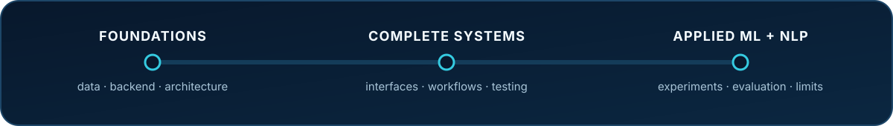

  

# Ranim Alyaseen

**Final-year Software Engineering student building complete systems and developing deeper capability in applied machine learning and NLP.**

My strongest foundation is in software engineering: designing data models, backend services, interfaces, and the boundaries that keep a system reliable. I am extending that foundation into ML and NLP through reproducible experiments, careful evaluation, and honest reporting of limitations.

  

## Featured engineering work

### [Orcha — AI Agent Management Platform](https://github.com/RanimAlyaseen/Orcha-App)

A full-stack control plane for managing agents, tasks, customer records, events, and human review workflows.

- **Engineering focus:** multi-tenant data modeling, JWT authentication, role-aware workflows, REST APIs, dashboard views, Docker deployment, and end-to-end browser tests.
- **Core stack:** React, Vite, Node.js, Express, Prisma, PostgreSQL, Docker.

### [Tourism CRM DBMS](https://github.com/RanimAlyaseen/tourism-crm-dbms)

A portfolio-engineered MySQL database for bookings, customers, packages, agents, payments, reviews, and reporting.

- **Engineering focus:** relational integrity, TRY-only payment rules, atomic paid-balance tracking, guarded booking totals, transaction-safe concurrent payment validation, views, functions, and reproducible positive and negative tests.
- **Core stack:** MySQL 8, SQL, InnoDB transactions, PowerShell test runners.

### [Medical Abstract Disease Classification](https://github.com/RanimAlyaseen/team-ultron-medical-abstract-classification)

A Team Ultron course project comparing classical, neural, general-purpose transformer, and biomedical transformer approaches across five disease classes.

- **Evaluation focus:** dataset-overlap audit, deterministic stratified splits, validation-only model selection, Macro F1, error analysis, and a single locked-test evaluation. The selected BiomedBERT run recorded **0.8603 locked-test Macro F1**.
- **My documented contribution:** model training and comparison, BiomedBERT fine-tuning, benchmark construction, experiment and error analysis, and final-model evaluation.
- **Core stack:** Python, pandas, scikit-learn, PyTorch, Transformers.

### [Book High-Rating Prediction](https://github.com/RanimAlyaseen/book-rating-prediction)

A reproducible binary-classification study built around group-aware validation and an honest negative result.

- **Evaluation focus:** training-only model selection, a majority-class baseline, uncertainty estimates, tested serialization, and a Streamlit demonstration. The selected model did **not** establish a reliable held-out advantage over the baseline.
- **Core stack:** Python, pandas, scikit-learn, pytest, Streamlit.

## Research & technical studies

### [AI-Assisted Pulmonary Nodule Detection in Chest CT](https://drive.google.com/drive/folders/1t_D6z8vG5mqFVUuV0Yiw7lJgMr2kazwr?usp=sharing)

**Research & Pre-Prototype System Design** — literature synthesis, a proposed AI pipeline, evaluation methodology, clinical workflow design, and safety and regulatory considerations. This work does not claim a trained model, diagnostic results, clinical validation, or deployment.

The external folder's anonymous landing page was reachable during profile verification; the linked research artifacts remain the owner's source materials.

## Additional technical work

- [CASIE Event Argument Extraction](https://github.com/RanimAlyaseen/casie-event-argument-extraction) — a team NLP benchmark with event-conditioned scoring, validation-selected RoBERTa, checkpoint verification, and an explicit distinction between gold-trigger benchmark results and the unmeasured raw-text demo pipeline.
- [Icelandic ASR Dataset Preparation](https://github.com/RanimAlyaseen/icelandic-asr-project3) — reproducible preparation and integrity checks for a speaker/session-separated 20-hour Samrómur subset for Whisper and wav2vec 2.0 experiments; human listening and transcript-agreement review remain documented as pending.

## Technical foundation

**Used in published repositories**

- **Languages:** JavaScript, Python, SQL.
- **Application engineering:** React, Vite, Node.js, Express, REST APIs, Prisma.
- **Data systems:** PostgreSQL, MySQL, SQLite, relational modeling, transactions.
- **ML & NLP:** pandas, scikit-learn, PyTorch, Transformers, model comparison, leakage-aware splitting, Macro F1 and error analysis.
- **Engineering workflow:** Git, Docker, pytest, Playwright, reproducible scripts, technical documentation.

**Currently deepening**

- Applied NLP, biomedical language models, speech processing, and evaluation design.
- The connection between reliable software architecture and maintainable AI-enabled products.

## How I approach engineering

- Start with the system boundary, data contract, and failure cases.
- Make important behavior reproducible and testable.
- Separate measured results from assumptions and future work.
- Document limitations as part of the engineering result.

## Connect

[GitHub](https://github.com/RanimAlyaseen) · [LinkedIn](https://www.linkedin.com/in/ranim-alyaseen-846522373)

Team and university projects are identified as such in their repositories. Contribution claims above follow the published attribution records.
