<a href="https://orcha-official.up.railway.app">Canlı demoyu aç</a> · <a href="https://github.com/RanimAlyaseen/Orcha-App">Kaynak</a>

<a href="https://github.com/RanimAlyaseen/casie-event-argument-extraction">Kaynak</a>

<a href="https://github.com/RanimAlyaseen/tourism-crm-dbms">Kaynak</a>

<table><tr>
<td width="33%"></td>
<td width="33%"></td>
<td width="33%"></td>
</tr></table>

<a href="https://drive.google.com/drive/folders/1t_D6z8vG5mqFVUuV0Yiw7lJgMr2kazwr?usp=sharing">Araştırma klasörünü aç</a>

Ekip ve üniversite projeleri, depolarında bu şekilde belirtilmiştir. Yukarıdaki katkı beyanları yayımlanmış atıf kayıtlarına dayanır.

