

> **Özet:** Tam kapsamlı ürünler çıkaran, ML deneylerini dürüstçe yürüten ve çevresindeki görselleri tasarlayıp kurgulayan son sınıf yazılım mühendisliği öğrencisi.


Ben Ranim, İstanbul'da İstinye Üniversitesi'nde yazılım mühendisliği son sınıf öğrencisiyim. İngilizce, Arapça ve Türkçe çalışıyorum ve zamanımı üç zanaat arasında bölüyorum: yazılım geliştirmek, video kurgulamak ve görsel tasarlamak. Üçünün ortak noktası benim için en önemli kısım: bir şeyi anlaşılır kılmak ve biri onu zorladığında ayakta kalmasını sağlamak. Bu sayfa, yönetmen kurgusu.



Şirketler yapay zekâ ajanlarını WhatsApp'a, telefon hatlarına, web sohbetine ve e-postaya yerleştiriyor. Sonra pratik bir soru çıkıyor: **Bu ajanları kim izliyor?** Orcha benim cevabım. Bir ekibin çalıştırdığı her ajan için tek kontrol paneli: görevler, müşteri kayıtları, olay günlükleri ve analitik; ayrıca işaretlenen çıktının müşteriye ulaşmadan *önce* bir insan tarafından onaylandığı, düzenlendiği ya da reddedildiği bir inceleme kuyruğu.

Çok kiracılı (multi-tenant) yapıda; rol tabanlı erişim, JWT kimlik doğrulama, e-posta doğrulama ve hız sınırlama içeriyor. Railway üzerinde yayında, Nginx arkasında Docker ile çalışıyor ve 7 Playwright uçtan uca testiyle kapsanıyor. Canlı demo, dört ajanı ve Arapça/İngilizce iki dilli olay günlükleri olan kurgusal bir klinik etrafında kurulu (giriş bilgileri deponun README dosyasında).

**Teknolojiler:** React 18 · Vite · Node.js / Express · Prisma · PostgreSQL · Docker

[Canlı demoyu aç](https://orcha-official.up.railway.app) · [Kodu oku](https://github.com/RanimAlyaseen/Orcha-App)



İstinye Üniversitesi'ndeki beş kişilik bir NLP ders projesinde görev, tıbbi makale özetlerini beş hastalık kategorisine ayırmaktı. Herhangi bir eğitimden önce ekip veriyi denetledi ve bir sorun buldu: 14.438 satırın yalnızca 11.227'si benzersiz metindi, **988 özet hem eğitim hem test dosyasında yer alıyordu** ve 2.929 özet grubu çelişkili etiketler taşıyordu. Eğitim verisiyle örtüşen bir test seti hiçbir şeyi ölçmez.

Bu yüzden ekip veriyi temizledi, bölümleri yeniden kurdu, modelleri yalnızca doğrulama setinde seçti ve test setine tam bir kez baktı. Benim payım model eğitimi ve karşılaştırması, BiomedBERT ince ayarı, kıyaslama kurulumu, hata analizi ve nihai değerlendirmeydi. BiomedBERT, **doğrulamada 0,8672 ve kilitli testte 0,8603 makro F1** ile kazandı. Yalnızca 0,0069'luk fark, skorun sağlam olduğunu gösteriyor.

[Kaynak ve belgeler](https://github.com/RanimAlyaseen/team-ultron-medical-abstract-classification)



Her deney kazanmaz. Tekrarlanabilir bir deney olarak yeniden kurduğum bir üniversite ML projesinde amaç, altı üstveri alanından bir kitabın puanının 4,6 veya üzeri olup olmadığını tahmin etmekti (348 kitap). Grup duyarlı bölümler kullandım, modelleri yalnızca eğitim verisiyle seçtim ve her şeyi çoğunluk sınıfı referansıyla karşılaştırdım.

Sonuç: seçilen Lojistik Regresyon, ayrılmış veride 0,457 doğruluk ve 0,433 ROC-AUC aldı; yani **referansa karşı güvenilir bir üstünlük yok**. Sınırlarını yazarak tam olarak böyle yayınladım, çünkü net bir olumsuz sonuç da bir sonuçtur. Streamlit demosu ve otomatik testler projeyle birlikte geliyor.

[Kaynak ve belgeler](https://github.com/RanimAlyaseen/book-rating-prediction)



Sayılara güvenilemiyorsa bir CRM işe yaramaz. Bir turizm CRM veritabanında (üniversite DBMS projesi; tekrarlanabilir bir MySQL deposu olarak yeniden kuruldu) kuralları veritabanının içine koydum: dokuz tablo, üç raporlama görünümü, iki fonksiyon ve altı tetikleyici.

Bir rezervasyona fazla ödeme yapacak bir ödemeyi **tetikleyici reddeder**. Bir yorum, rezervasyonun sahibi müşteriye ait olmak zorundadır; bu, bileşik yabancı anahtarla zorunlu kılınır. SQL test senaryoları ve kontrollü iki oturumlu eşzamanlılık testleri bunu kanıtlar. Yalnızca veritabanı katmanı; web arayüzü yok.

[Kaynak ve belgeler](https://github.com/RanimAlyaseen/tourism-crm-dbms)



[CASIE](https://github.com/RanimAlyaseen/casie-event-argument-extraction) · [Icelandic ASR](https://github.com/RanimAlyaseen/icelandic-asr-project3) · [Akciğer nodülü çalışması](https://drive.google.com/drive/folders/1t_D6z8vG5mqFVUuV0Yiw7lJgMr2kazwr?usp=sharing)





<a href="https://www.linkedin.com/in/ranim-alyaseen-846522373"></a>
<a href="https://github.com/RanimAlyaseen?tab=repositories"></a>
<a href="https://drive.google.com/drive/folders/1t_D6z8vG5mqFVUuV0Yiw7lJgMr2kazwr?usp=sharing"></a>

Takım ve üniversite projeleri, depolarında bu şekilde belirtilmiştir. Katkı beyanları yayımlanmış atıf kayıtlarına dayanır.
